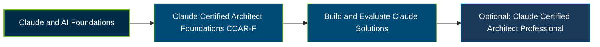

# Anthropic Claude Certified Architect – Foundations Certification Exam Guide

A dedicated study guide and technical reference repository for candidates preparing for the **Anthropic Claude Certified Architect – Foundations (CCAR-F) Certification Exam**, covering Claude solution architecture, agentic workflows, and production-focused implementation.

---

## Exam Overview

The Claude Certified Architect – Foundations certification validates the ability to scope and design Claude-based solutions, including architecture choices, agentic workflows, integrations, and reliable implementation.

- **Exam Format**: Proctored multiple-choice and multiple-response examination, available online or at a Pearson VUE test center.
- **Target Audience**: Solution architects, technical leads, and practitioners designing and implementing Claude-based solutions.
- **Prerequisites**: No formal prerequisite certification is stated; exam registration is available to organizations in the Claude Partner Network.

---

## Core Exam Domains & Knowledge Areas

### 1. Agentic Architecture & Orchestration

- Agentic application design, execution loops, and orchestration patterns.
- Multi-agent workflows, delegation, and task coordination.
- Claude Agent SDK concepts and reliable agent execution.

### 2. Tool Design & MCP Integration

- Tool schemas, definitions, and effective tool-use patterns.
- Model Context Protocol (MCP) servers, clients, and integrations.
- Connecting Claude applications with external services and resources.

### 3. Claude Code Configuration & Workflows

- Claude Code configuration, settings, and project instructions.
- Development workflows, hooks, permissions, and automation.
- Integrating Claude Code into team and software development processes.

### 4. Prompt Engineering & Structured Output

- Prompt design, refinement, and instruction techniques.
- Structured outputs, schema-based responses, and validation.
- Reliable extraction and response formatting for application workflows.

### 5. Context Management & Reliability

- Context-window management and conversation continuity.
- Context handling, caching strategies, and information organization.
- Reliability considerations for long-running and production workflows.

---

## Certification Path

---

## Recommended Practice & Study Resources

Combine official Anthropic learning materials with practical implementation and focused exam preparation.

- **CertsGate**: Explore [CCAR-F certification preparation resources](https://certsgate.com/exams/anthropic/ccar-f), including supplementary practice questions and study materials.
- **Anthropic Documentation & MCP**: Build practical knowledge using the [Claude documentation](https://docs.anthropic.com/) and [Model Context Protocol documentation](https://modelcontextprotocol.io/), focusing on agent workflows, tool integration, and reliable application design.
